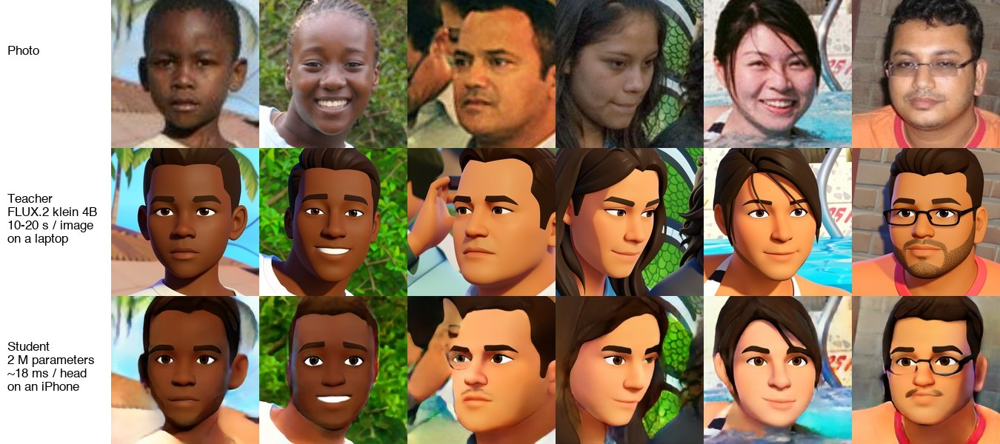

# Real-time AI Filter in the Browser

**Run an AI image model live on your phone's camera, entirely in the browser. No server, no app, no cost.**

**▶ [Try it now in your browser](https://cmoirox.github.io/realtime-ai-filter-in-browser/)**

A real-time AI camera filter that runs 100 % client-side with **WebGPU** (LiteRT.js), including in **mobile Safari on iPhone**. A 4-billion-parameter diffusion image editor (FLUX.2 klein 4B) was distilled into a 2-million-parameter network that restyles every person in the camera feed at 14–60 fps. Nothing leaves the device.

If you have been looking for any of the following, this repo shows how to do it end to end, with the code, the weights and the measurements:

- an AI face filter or style transfer that runs in the browser, in real time, with no backend;
- a way to run a neural network on the GPU of a phone from a web page (WebGPU, LiteRT.js / TFLite);
- a way to make a diffusion model (FLUX, Stable Diffusion…) fast enough for live video by distilling it into a tiny model.



<sub>Held-out faces from <a href="https://github.com/joojs/fairface">FairFace</a> (CC BY 4.0). Top: photo. Middle: teacher. Bottom: the distilled student that runs in the browser.</sub>

---

## Why this is interesting

- **Distillation that actually ships to a phone browser.** The teacher takes 10–20 s per 512² image on a laptop GPU. The student takes **~18–20 ms per head on an iPhone 13-class device in Safari** (WebGPU) and is 7.9 MB.
- **Whole-head restyling, every frame, no face mesh.** Each detected head is cropped into an aligned square, restyled, and pasted back with a soft edge, clipped to the person's silhouette by a second tiny model (hair / skin / occluders, 1.7 MB, ~10 ms). Hands in front of the face stay real.
- **Temporal stability without recurrent state.** A shift-consistency loss during training (the output of a shifted, re-noised frame must equal the shifted output) keeps the video from flickering.
- **Fairer teacher data through automatic prompting.** Out of the box, the diffusion teacher lightened dark skin and changed hair colour. A local vision-language model (Qwen2.5-VL 7B) now describes each face (skin tone, hair, facial hair, glasses), and that description is written into the teacher prompt. The face set is rebalanced with FairFace and ~740 profile views.
- **Measured, not guessed.** Five browser inference engines were benchmarked on a real iPhone. LiteRT.js on WebGPU was **6× faster** than the next best (ONNX Runtime Web, TF.js, WASM). See [docs/benchmarks.md](docs/benchmarks.md).
- **Runs end to end on one laptop.** Teacher, describer, dataset generation and training all ran locally on a MacBook Pro (Apple M5 Pro, PyTorch MPS + MLX).

## Results

| | iPhone 13-class, Safari 26, WebGPU |
|---|---|
| No face in view | 60 fps (display-capped) |
| One face (head model 20 ms + zones 10 ms + face landmarks 30 ms) | 14–16 fps |
| Head model alone, 256 × 256 | 18–20 ms |
| Zones model alone, 160 × 160 | 8–13 ms |
| Model files | 7.9 MB (head) + 1.7 MB (zones), float32 `.tflite` |

On the phone, face landmark detection costs more than the restyling network itself.

## Try it

### ▶ [Try the live demo](https://cmoirox.github.io/realtime-ai-filter-in-browser/)

Open it on your phone (iPhone with Safari 26+, or a recent Android/desktop browser with WebGPU), tap **Start camera** and point the camera at people. Use **Flip camera** to restyle yourself. Everything runs on your device: no video is uploaded.

Run it locally:

```bash
cd web
npm install
npm run models     # downloads the released weights + MediaPipe Face Landmarker into public/models/
npm run dev        # open the printed URL; use a tunnel (e.g. cloudflared) or mkcert for HTTPS on a phone
```

URL options: `?video=clip.mp4` (a file instead of the camera), `?pixel=1` (low-res "pixel" filter that hides seams), `?eyelids=0`, `?zones=0`, `?faces=3`.

Offline, on a video file (Python):

```bash
uv run --python 3.11 --with torch --with mediapipe --with opencv-python-headless --with numpy \
  python tools/video_demo.py input.mp4 output.mp4 g32:weights/head_g32.pt:256
```

## How it works

```
                OFFLINE (one laptop)                                         ONLINE (phone browser)

 public photos ─► face detection + aligned crop ─┐                camera frame
 (COCO, Wikimedia,                               │                    │
  FairFace)        Qwen2.5-VL describes each face│                    ├─► MediaPipe Face Landmarker ─► aligned head squares
                                ▼                ▼                    │                                    │
                  FLUX.2 klein 4B (teacher) restyles 512² crops       ├─► zones model (silhouette) ──┐     ▼
                                ▼                                     │                              │  head model (student)
                  automatic QC: landmarks moved? structure changed?   │                              ▼     │
                                ▼                                     └────────────► soft-edge paste, clipped to silhouette
                  ~4,300 clean pairs ─► train student (L1 + VGG +                         ▼
                  PatchGAN + shift-consistency) ─► fuse BN ─► .tflite      optional pixel filter ─► screen
```

Full write-up: [docs/how-it-works.md](docs/how-it-works.md).

## Train your own style

The pipeline doesn't depend on the look. Change the teacher prompt in [`teacher/prompts.py`](teacher/prompts.py) (claymation, anime, oil paint, comic…), regenerate the pairs and retrain. Step-by-step guide with commands and timings: [docs/train-your-own-style.md](docs/train-your-own-style.md).

## Repository layout

```
teacher/   building the dataset: source photos, face crops, descriptions, diffusion restyling, quality control, splits
student/   the network (model.py), training (train.py, train_zones.py), export to .tflite with an exactness check
tools/     offline video demo
web/       the browser demo (TypeScript + Vite, LiteRT.js, MediaPipe)
weights/   released weights (attached to GitHub Releases, not committed)
docs/      how it works, benchmarks, retraining guide
```

### Data layout

The scripts create these folders, which are not committed (see `.gitignore`):

```
data/
  sources/<origin>/<category>/*.jpg        source photos (coco, wikimedia, fairface)
  scenes/{photo,styled}/*.png              whole-scene pairs, 512²
  faces/{photo,styled}/*.png               aligned face pairs, 512²  (+ descriptions.csv, quality.csv, sample_weights.csv…)
  faces/profiles/{photo,styled}/           side and three-quarter views
  splits/{scenes,faces}_{train,val,test}.txt
  zones/{scenes,faces}/*.png               MediaPipe labels for the zones model
  cache/                                   training caches (.npy)
models/    third-party weights: FLUX.2 klein 4B (mflux q8), face_landmarker.task, selfie_multiclass_256x256.tflite, yolov8n.pt
runs/      training outputs (checkpoints, per-epoch contact sheets, logs)
exports/   exported .tflite files
```

## Limitations

- Grey and white hair often comes out brown or blond, and bald heads can get hair (or the reverse).
- The head model always draws open eyes. Blinks and winks are drawn on top as eyelids in the restyled skin colour, and eyes kept closed for more than 5 s are reopened.
- Sunglasses smear, and thin glasses are sometimes dropped. Light stubble tends to be shaved off.
- Heads looking down, and faces lost by the landmark detector (full profile, very small, heavy occlusion), are not restyled.
- Measured only on iPhones with Safari 26. Some Android and Windows laptops (Chrome) ran at 6–8 fps for reasons that are not yet understood.
- Only the head is restyled. The rest of the scene goes through a cheap filter, because full-frame student models were too slow on the phone (8–13 fps).

See [MODEL_CARD.md](MODEL_CARD.md) for data, intended use and bias notes.

## Credits

- Teacher: [FLUX.2 klein 4B](https://huggingface.co/black-forest-labs/FLUX.2-klein-4B) by Black Forest Labs (Apache 2.0), run with [mflux](https://github.com/filipstrand/mflux).
- Face describer: [Qwen2.5-VL 7B](https://huggingface.co/Qwen/Qwen2.5-VL-7B-Instruct) (4-bit MLX), run with [mlx-vlm](https://github.com/Blaizzy/mlx-vlm).
- Browser inference: [LiteRT.js](https://ai.google.dev/edge/litert/web) · face landmarks and teacher for the zones model: [MediaPipe](https://ai.google.dev/edge/mediapipe) (Apache 2.0).
- Data: [COCO](https://cocodataset.org), [Wikimedia Commons](https://commons.wikimedia.org) (per-file credits are written by `teacher/download_wikimedia.py`), [FairFace](https://github.com/joojs/fairface) (CC BY 4.0).
- Prior work this builds on: [E²GAN](https://arxiv.org/abs/2401.06127) (distilling diffusion editing into mobile GANs), [pix2pix](https://github.com/junyanz/pytorch-CycleGAN-and-pix2pix), [animeganv3-browser](https://github.com/ldenoue/animeganv3-browser).

## License

Code and released weights: [MIT](LICENSE). The training data comes from third-party datasets with their own licenses (see [MODEL_CARD.md](MODEL_CARD.md)). If you build on this, please cite it (see [CITATION.cff](CITATION.cff)).
